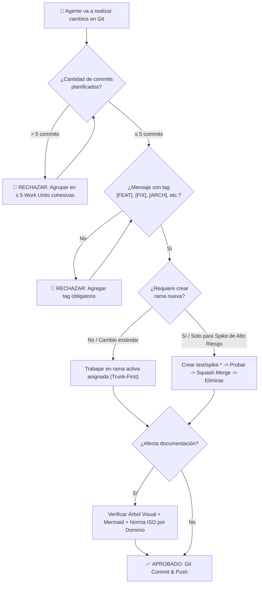

# 🛡️ Agent GitHub Improvement Protocol

> **Estándar y Protocolo Obligatorio para Agentes Autónomos:** Buenas prácticas de Git, erradicación de micro-commits desordenados de IA, control de branches y documentación técnica profesional con normas ISO.

[](LICENSE)
[](#)
[](#)
[](#)

---

## 🎯 Por Qué Existe este Protocolo

Muchos agentes y modelos de IA generan código a gran velocidad pero introducen vicios graves en los repositorios:
1. **Micro-commit spam:** 15 a 30 commits consecutivos por tareas mínimas (`fix typo`, `update var`, `add test`), saturando el historial y destruyendo la trazabilidad.
2. **Proliferación de ramas caóticas:** Crear ramas para cada ajuste trivial que luego quedan abandonadas.
3. **Documentación genérica (AI Slop):** READMEs vacíos o superficiales que carecen de diagramas de arquitectura reales y no siguen estándares internacionales.

Este repositorio define la **skill y especificación normativa `agent-github-improvement`** para transformar agentes en ingenieros de software senior disciplinados.

---

## 🏗️ Flujo de Operación del Agente



---

## 📁 Estructura del Repositorio

```text
agent-github-improvement/
├── SKILL.md                                 # Manifiesto ejecutable y contrato de la skill
├── references/
│   ├── commit-batching-and-tagging.md       # Regla ≤ 5 commits, unidades cohesivas y tags
│   ├── branching-policy.md                  # Filosofía trunk-first y branches para spikes
│   └── iso-standards-guide.md               # Matriz de normas ISO por tipo de proyecto
├── examples/
│   ├── documentation-templates.md           # Plantillas completas de README (Web, AI, Data)
│   └── real-world-scenarios.md              # 3 Casos prácticos de ejecución paso a paso
├── LICENSE                                  # Licencia MIT
└── README.md                                # Documentación principal del protocolo
```

---

## 📌 Los 4 Pilares Fundamentales

### 1. Límite de Commits Anti-Spam (Máx. 5 por Lote)
Los agentes tienen prohibido generar más de 5 commits por sesión/bloque de trabajo en un proyecto. Cada commit debe ser una **Unidad de Trabajo Cohesiva (Work Unit)** que combine código, pruebas y documentación asociada en un solo bloque funcionalmente independiente.

### 2. Tagging Obligatorio
Todo mensaje de commit debe comenzar con un tag semántico en mayúsculas:
- `[FEAT]`: Nuevas funcionalidades y capacidades.
- `[FIX]`: Corrección de errores y excepciones.
- `[ARCH]`: Refactorizaciones estructurales y Clean Architecture.
- `[DOCS]`: Documentación técnica, diagramas y normas ISO.
- `[TEST]`: Suites de pruebas unitarias, integración o E2E.
- `[PERF]`: Optimizaciones de latencia, queries o recursos.
- `[CONFIG]`: Tooling, Docker, CI/CD y variables de entorno.

### 3. Política de Ramas Exclusiva para Tests y Spikes
No se crean ramas arbitrarias. Se trabaja en la rama designada (`main` o `feature/activa`). Solo se permite crear branches temporales bajo el prefijo `test/spike-*` para evaluar librerías desconocidas, benchmarks o migraciones de alto riesgo, y **deben eliminarse tras integrarse limpiamente vía squash**.

### 4. Mapeo de Normas ISO en Documentación
Toda documentación técnica producida debe contener el árbol de directorios, diagrama visual `mermaid` y la sección de cumplimiento normativo según su dominio:
- **ISO/IEC 25010:** Calidad de producto software (mantenibilidad, rendimiento, fiabilidad).
- **ISO/IEC 12207:** Procesos del ciclo de vida y metodologías SDD/TDD.
- **ISO/IEC 27001:** Seguridad de la información, gestión de secretos y zero-trust.
- **ISO/IEC 42001:** Gobernanza de sistemas de IA, control de loops y mitigación de sesgos.
- **ISO 8000:** Calidad y consistencia en pipelines de datos y scraping.
- **ISO/IEC/IEEE 26514:** Estructura cognitiva y claridad en manuales técnicos.

---

## ⚡ Instalación en Agentes Autónomos

### Como Skill de Antigravity / Gentle AI / Claude Code:
Copia la carpeta en el directorio de skills de tu plataforma:

```bash
# Antigravity CLI / Gemini
cp -r agent-github-improvement ~/.gemini/antigravity-cli/skills/

# Claude Code / Codex / OMP
cp -r agent-github-improvement ~/.claude/skills/
```

### Regla de Invocación en `AGENTS.md`:
Agrega esta directiva a tus archivos `AGENTS.md` para forzar su uso continuo:

```markdown
- GIT & DOCUMENTATION MANDATE: Before committing, creating branches, or writing docs, agents MUST execute `agent-github-improvement`: (1) Max 5 commits per batch, (2) Mandatory tags [FEAT], [FIX], [ARCH], [DOCS], [TEST], [PERF], [CONFIG], (3) Trunk-first discipline (branches strictly for isolated test spikes), (4) All documentation must feature a visual directory tree, Mermaid architecture, and domain-mapped ISO standards (ISO 25010, 12207, 27001, 42001, 8000, 26514).
```

---

## 🛡️ Cumplimiento de Estándares Internacionales (Normas ISO)

- **ISO/IEC 12207 (Software Life Cycle Processes):** Estandariza la trazabilidad en el control de versiones, impidiendo la fragmentación de cambios en micro-commits y asegurando releases reproducibles.
- **ISO/IEC 42001 (AI Management System):** Controla el comportamiento no determinista de los agentes de IA, estableciendo guardrails operacionales para prevenir la contaminación de repositorios de código abierto.
- **ISO/IEC/IEEE 26514 (Software Documentation):** Provee plantillas visuales estructuradas que maximizan la comprensión y reducen la fatiga cognitiva del desarrollador humano.

---

## 📄 Licencia

Distribuido bajo la Licencia MIT. Consulta el archivo [LICENSE](LICENSE) para más información.
