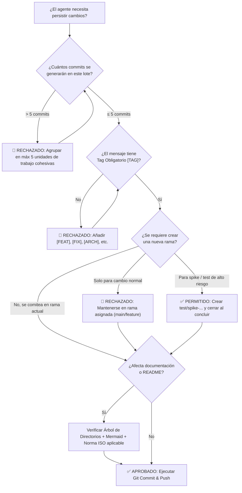

# Agent GitHub Improvement Protocol

> **Estado:** Obligatorio para todos los agentes autónomos, subagentes y herramientas de automatización.  
> **Propósito:** Erradicar patrones de "IA desordenada" (micro-commits masivos, ramas caóticas, documentación superficial) y elevar la calidad de Git e ingeniería de software a estándares profesionales internacionales.

---

## 📌 Resumen Ejecutivo de Reglas Críticas

| Regla | Restricción Estricta | Referencia Detallada |
|---|---|---|
| **Límite de Commits** | **Máximo 5 commits** por tarea, sesión o lote en un proyecto. Prohibido el micro-commit spam. | [commit-batching-and-tagging.md](references/commit-batching-and-tagging.md) |
| **Tagging Obligatorio** | Todo commit DEBE llevar prefijo semántico: `[FEAT]`, `[FIX]`, `[ARCH]`, `[DOCS]`, `[TEST]`, `[PERF]` o `[CONFIG]`. | [commit-batching-and-tagging.md](references/commit-batching-and-tagging.md) |
| **Política de Ramas** | Trabajar en la rama asignada (`main` o `feature`). Crear branches **solo y exclusivamente** para tests/spikes aislados de alto riesgo. | [branching-policy.md](references/branching-policy.md) |
| **Documentación & Árbol** | Todo proyecto documentado debe incluir estructura de directorios visual (`tree`) y diagrama de arquitectura (`mermaid`). | [documentation-templates.md](examples/documentation-templates.md) |
| **Normas ISO por Dominio** | Toda documentación técnica debe mapear y cumplir con la norma ISO pertinente (ISO 25010, 12207, 27001, 42001, 8000, 26514). | [iso-standards-guide.md](references/iso-standards-guide.md) |

---

## 🧭 Estructura de la Skill

Esta skill está modularizada en guías operativas y plantillas de casos reales:

```
agent-github-improvement/
├── SKILL.md                                 # Guía central, reglas críticas y checklist de ejecución
├── references/
│   ├── commit-batching-and-tagging.md       # Regla de los 5 commits, unidades cohesivas y tags
│   ├── branching-policy.md                  # Filosofía trunk-first y branches exclusivas para spikes
│   └── iso-standards-guide.md               # Guía exhaustiva de normas ISO por tipo de proyecto
└── examples/
    ├── documentation-templates.md           # Plantillas completas de README y arquitectura (Web, AI, Data)
    └── real-world-scenarios.md              # 3 Casos prácticos de ejecución paso a paso
```

---

## 🚦 Flujo de Decisión Pre-Commit (Gate Obligatorio)

Antes de invocar cualquier comando de Git (`git commit`, `git push`, `git checkout -b`), el agente DEBE ejecutar mentalmente este flujo:



---

## ✅ Checklist de Validación Inmediata

Antes de finalizar cualquier respuesta donde se haya tocado Git:
1. `git log -n 5 --oneline` muestra mensajes claros con sus respectivos tags entre corchetes `[FEAT]`, `[FIX]`, etc.
2. No se dejaron ramas temporales huérfanas o sin justificación de testeo crítico.
3. Los cambios de documentación cumplen con el formato estructurado y hacen referencia explícita a la norma ISO correspondiente.
