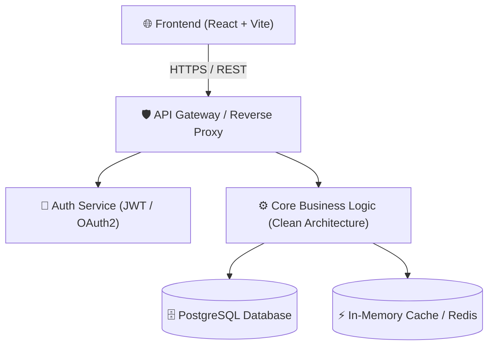
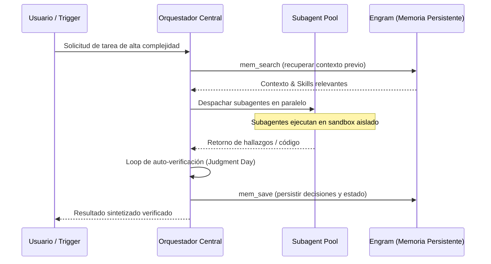
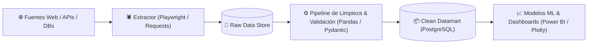

# Plantillas de Documentación de Proyectos (README & Architecture)

Este documento contiene 3 plantillas estandarizadas listas para adaptar y desplegar en cualquier repositorio.

---

## Plantilla 1: Aplicación Web / Cloud Fullstack

```markdown
# 🚀 [Nombre del Proyecto]

> Breve descripción de alto impacto (1-2 oraciones) explicando el valor del producto y el problema que resuelve.

---

## 🏗️ Arquitectura del Sistema



---

## 📁 Estructura del Proyecto

```text
nombre-del-proyecto/
├── src/
│   ├── core/                  # Dominio puro y casos de uso (sin dependencias externas)
│   │   ├── entities/
│   │   └── use_cases/
│   ├── adapters/              # Controladores, adaptadores de DB y repositorios
│   │   ├── controllers/
│   │   └── database/
│   └── infrastructure/        # Frameworks, servidores HTTP y configuración
│       ├── api/
│       └── config/
├── tests/
│   ├── unit/                  # Pruebas unitarias de dominio
│   └── integration/           # Pruebas de integración con DB/API
├── .env.example
├── docker-compose.yml
└── README.md
```

---

## ⚡ Guía de Inicio Rápido

### Prerrequisitos
- Node.js ≥ 20.x o Python ≥ 3.11
- Docker & Docker Compose

### Instalación y Ejecución
```bash
# 1. Clonar el repositorio
git clone https://github.com/usuario/nombre-del-proyecto.git
cd nombre-del-proyecto

# 2. Configurar variables de entorno
cp .env.example .env

# 3. Levantar servicios locales
docker compose up -d
```

---

## 🛡️ Estándares de Ingeniería & Normas ISO

- **ISO/IEC 25010 (Calidad del Producto Software):**
  - **Mantenibilidad:** Separación estricta de capas mediante Clean Architecture; las reglas de negocio no dependen de librerías externas.
  - **Eficiencia de Desempeño:** Tiempos de respuesta < 120ms mediante caching y queries optimizadas.
  - **Fiabilidad:** Cobertura de pruebas unitarias y de integración > 85%.
- **ISO/IEC 27001 (Seguridad de la Información):**
  - Cero secretos almacenados en el repositorio.
  - Autenticación robusta con hashing seguro de contraseñas y sanitización contra inyecciones SQL y XSS.
```

---

## Plantilla 2: Sistema de IA Agéntica & Multi-Agente

```markdown
# 🤖 [Nombre del Sistema Agéntico]

> Plataforma multi-agente para la ejecución autónoma de flujos complejos mediante orquestación jerárquica y loops de retroalimentación.

---

## 🧠 Topología Multi-Agente & Flujo de Ejecución



---

## 📁 Estructura del Repositorio

```text
sistema-agentico/
├── agents/                    # Definiciones de roles y prompts de subagentes
│   ├── orchestrator.py
│   └── workers/
├── skills/                    # Habilidades dinámicas ejecutables (LLM-First)
│   ├── research/
│   └── code_executor/
├── memory/                    # Interfaces de almacenamiento y MCP
├── tools/                     # Wrappers de herramientas (Playwright, API, Git)
├── tests/                     # Suites de evaluación de comportamiento agéntico
└── README.md
```

---

## 🛡️ Gobernanza de IA & Normas ISO

- **ISO/IEC 42001 (Gestión de Sistemas de IA):**
  - **Trazabilidad:** Cada acción tomada por un subagente queda registrada en logs de auditoría estructurados con ID de sesión y timestamps.
  - **Control de Bucles (Safety Loops):** Límite máximo de iteraciones autónomas (circuit-breaker) para evitar loops infinitos y gasto descontrolado de tokens.
  - **Mitigación de Alucinaciones:** Fase de verificación obligatoria donde un evaluador independiente valida las salidas antes de persistir cambios.
- **ISO/IEC 12207 (Ciclo de Vida de Software):**
  - Implementación gobernada por fases SDD (`explore → propose → spec → design → tasks → apply → verify → archive`).
```

---

## Plantilla 3: Pipeline de Data Science, ETL & Web Scraping

```markdown
# 📊 [Nombre del Pipeline / Data Engine]

> Pipeline automatizado de extracción masiva, normalización, auditoría y análisis de datos en tiempo real.

---

## 🔄 Flujo del Pipeline ETL



---

## 📁 Estructura del Pipeline

```text
data-pipeline/
├── data/
│   ├── raw/                   # Datos crudos inmutables (solo lectura)
│   └── processed/             # Conjuntos de datos curados y normalizados
├── src/
│   ├── extractors/            # Scripts de scraping y conectores de API
│   ├── transformers/          # Lógica de validación, tipado y limpieza
│   └── loaders/               # Inserción batch a PostgreSQL / Data Warehouse
├── schemas/                   # Esquemas de datos validados (Pydantic / SQL)
├── tests/                     # Pruebas de integridad de datos y regresión
└── README.md
```

---

## 🛡️ Calidad de Datos & Normas ISO

- **ISO 8000 (Calidad de Datos):**
  - **Completitud:** Reglas automáticas que rechazan o imputan registros con valores críticos faltantes.
  - **Consistencia:** Validación estricta de tipos de datos en la frontera de ingesta con tipado fuerte.
  - **Trazabilidad de Linaje (Data Lineage):** Cada registro transformado almacena el timestamp de extracción y la versión del schema utilizado.
- **ISO/IEC 25010 (Calidad de Software):**
  - Eficiencia en el procesamiento por lotes con consumo de memoria acotado (`chunking`).
```
