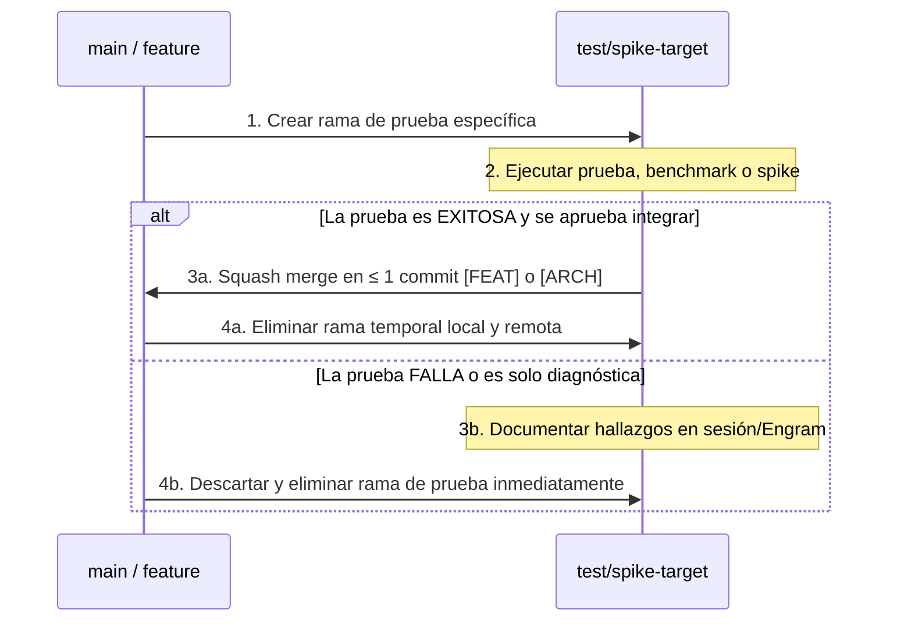

# Política de Branches: Disciplina Trunk-First y Excepciones de Testeo

## 1. Filosofía de Ramas Responsable

Muchos asistentes de IA cometen el error de crear ramas efímeras para cada cambio minúsculo (`update-readme`, `fix-button`, `change-color`), dejando repositorios llenos de branches abandonadas que nunca se borran ni se integran limpiamente.

La regla fundamental de este estándar es:
> **Trabajar de forma ordenada en la rama designada (`main` o la `feature/` activa acordada con el usuario). No crear ramas paralelas arbitrarias salvo que una prueba aislada de alto riesgo lo amerite explícitamente.**

---

## 2. La Excepción Exclusiva: Ramas de Testeo y Spikes

Se permite (y se recomienda) la creación de una rama temporal **únicamente y de forma excepcional** en los siguientes casos:

1. **Spikes Experimentales de Alto Riesgo:**
   - Evaluar si una biblioteca desconocida o de terceros funciona antes de comprometer el árbol principal.
   - Probar una arquitectura alternativa cuya viabilidad es incierta.
2. **Pruebas de Migración Destructiva:**
   - Cambios mayores en versiones de frameworks, bases de datos o esquemas que podrían corromper el entorno de trabajo.
3. **Benchmarks Comparativos A/B:**
   - Medir desempeño o latencia entre dos implementaciones competitivas.

---

## 3. Convención de Nombres para Ramas de Test

Si la excepción aplica, el nombre de la rama debe reflejar inequívocamente su propósito de prueba:

| Prefijo de Rama | Propósito | Ejemplo |
|---|---|---|
| `test/spike-*` | Prueba de concepto o evaluación técnica exploratoria | `test/spike-playwright-headless-canvas` |
| `test/bench-*` | Pruebas de rendimiento, estrés o carga | `test/bench-redis-vs-inmemory-cache` |
| `test/mig-*` | Validación de migración o actualización mayor | `test/mig-react-19-compatibility` |

---

## 4. Ciclo de Vida Obligatorio de una Rama de Test

El agente debe seguir un ciclo cerrado de 4 pasos sin dejar ramas huérfanas:



### Comandos de Ejemplo para Integración Limpia:
```bash
# Integrar la prueba exitosa como un único commit cohesivo
git checkout main
git merge --squash test/spike-playwright-headless-canvas
git commit -m "[FEAT] scraper: integrate tested headless canvas rendering"

# Eliminar inmediatamente la rama de testeo
git branch -D test/spike-playwright-headless-canvas
```
